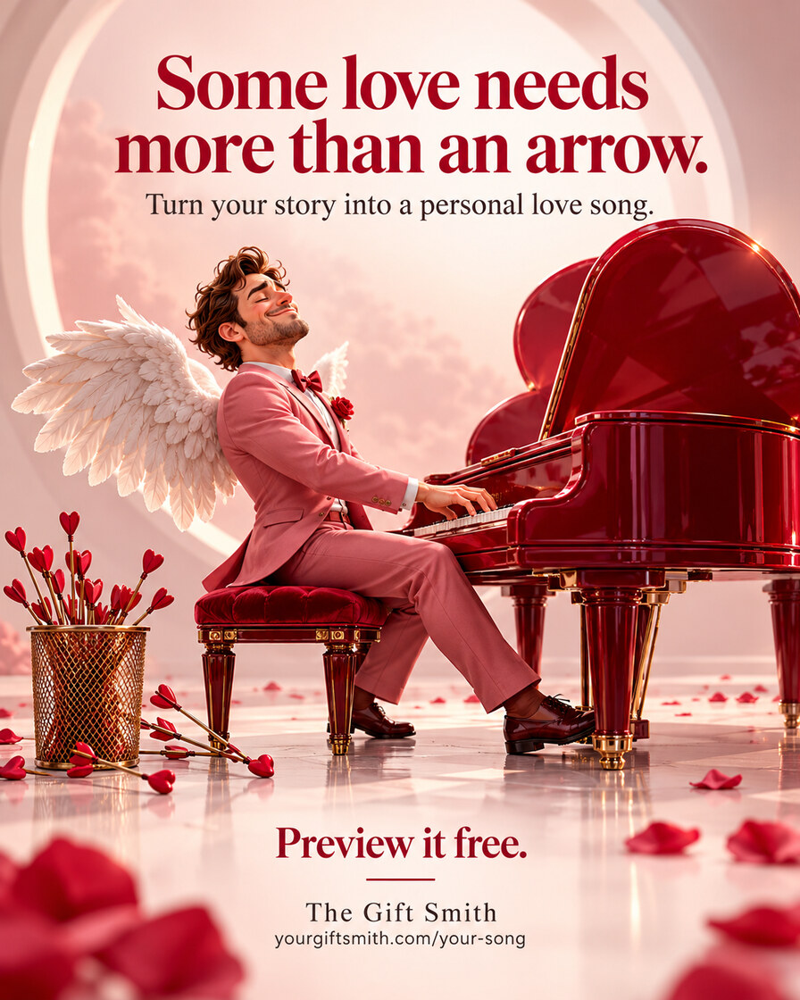
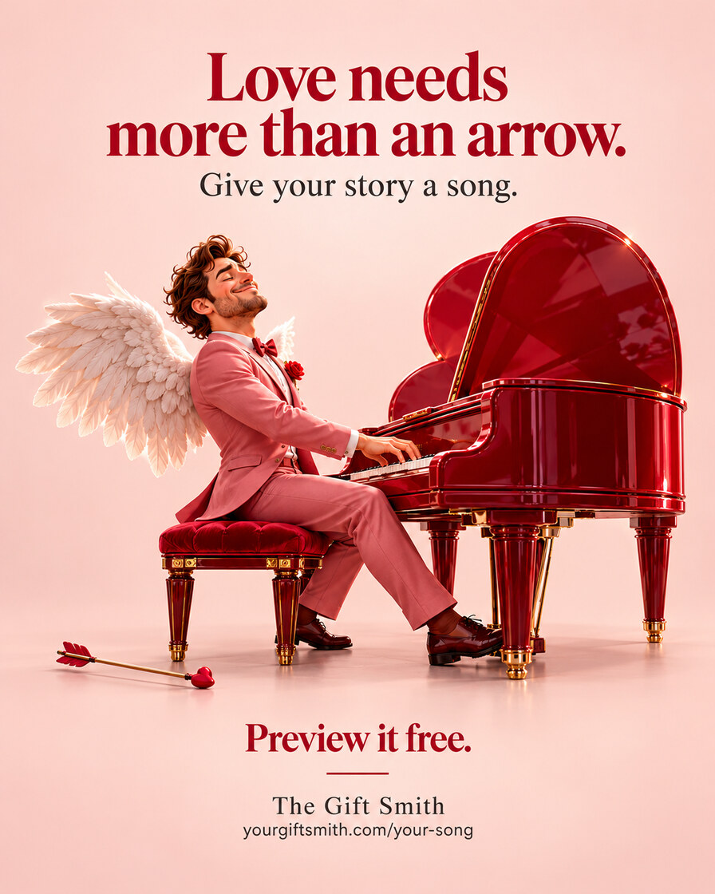
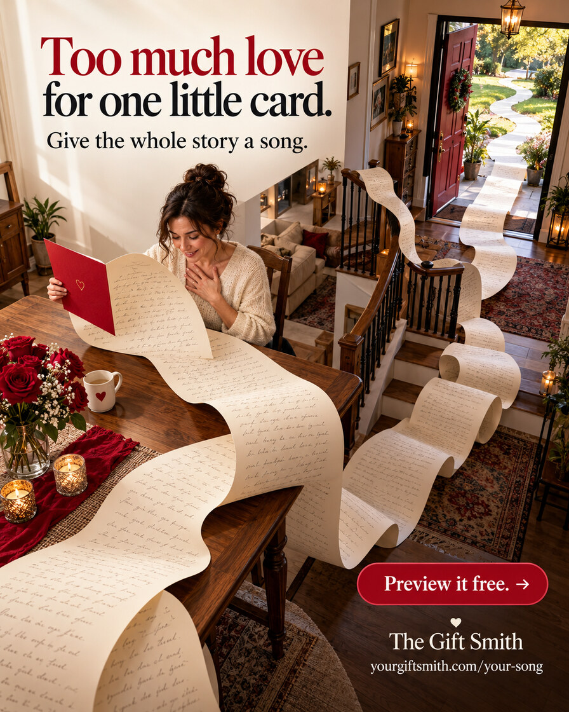
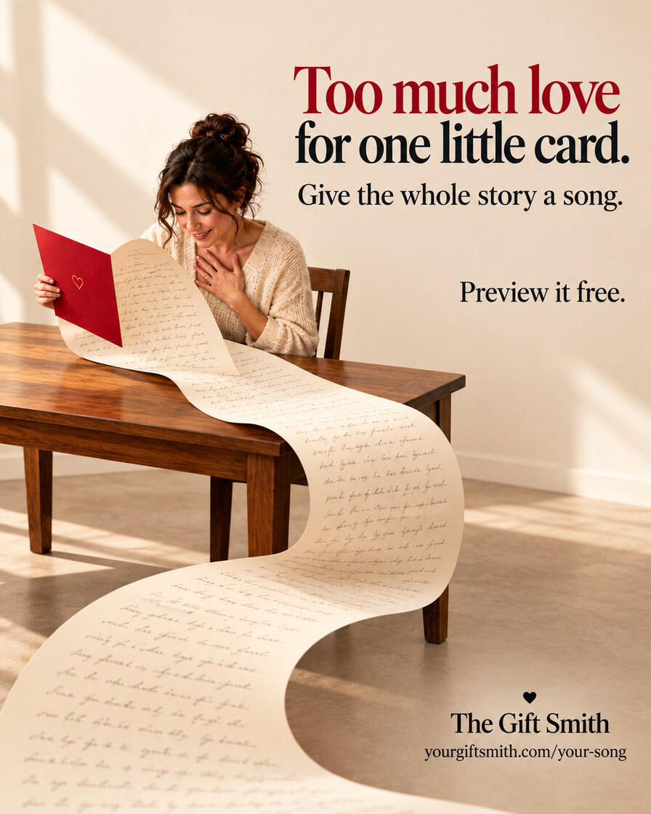
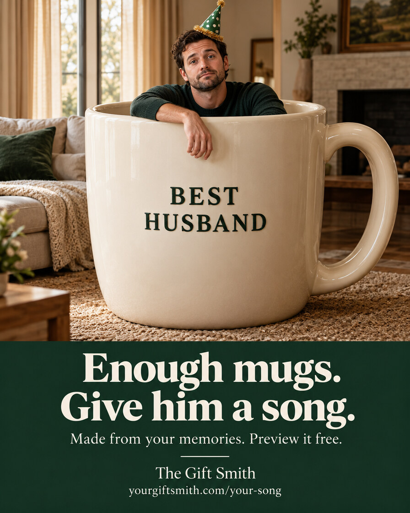

# Composition comparisons: preserve the idea, reduce competition

Use with [composition-review.md](../composition-review.md) and the required
[creative passes](../creative-passes.md); inspect the images when image viewing is
available. These are two selected pairs and one standalone benchmark of existing,
user-approved generated ads, not templates to copy or newly generated assets.

The user liked the original ideas and preferred the cleaner versions, while leaving
room for both styles. That is a creative preference, not conversion proof. Rich and
clean compositions can both work. Judge whether each detail earns its attention by
supporting the premise, emotional meaning, product connection or reading order. Do not
turn these examples into a minimalism rule, fixed element count, blank-background
recipe or cast mandate.

**Evidence boundary:** These are multi-variable creative comparisons, not controlled
single-variable tests. Copy, layout, scene detail and CTA treatment change across the
pairs. No audience experiment or conversion result is supplied. Branding and offer
wording remain visible only in this narrow, user-approved teaching example; neither
is current offer evidence, reusable proof or permission to publish these ads. The
fictional scenes and generated people are not customer testimonials.

## 1. Cupid off duty: keep the contradiction, reduce repeated decoration

| Original | Simplified |
| --- | --- |
|  |  |

- **Mechanism retained:** Cupid has traded arrows for music. Wings, heart-shaped piano
  and a discarded arrow give the headline a visible premise rather than decorating
  an otherwise generic musician portrait. The song is part of the resolution.
- **What changes:** The simplified scene removes the arrow basket, repeated arrows,
  scattered petals, foreground flowers and architectural arch. It retains the
  richly rendered character and piano, not merely an isolated product. The stronger
  separation around this group makes the main action easier to locate in this review.
- **Copy/layout confounds:** The headline loses “Some”; the support changes from
  “Turn your story into a personal love song.” to “Give your story a song.” Character
  and piano placement change too. “Preview it free.” remains the CTA in both.
- **Tradeoff:** The original's abandoned-arrow pile makes Cupid's change of method
  more explicit and the decorative setting adds romance. The simplified image gains
  breathing room but reduces that narrative evidence; the single arrow is a smaller
  clue at phone size. Shorter support is less explicit about personalization.
- **Use the lesson:** Remove redundant cues before removing the cue that makes the
  visual joke intelligible. Neither mythical casting nor a plain background is required.

## 2. Never-ending card: preserve the impossible scale, clarify its path

| Original | Simplified |
| --- | --- |
|  |  |

- **Mechanism retained:** A small card cannot contain the whole story. The impossible
  length makes that tension visible; the song copy supplies a way to express it.
- **What changes:** Stairs, open doorway, distant garden, patterned rugs, flowers,
  candles and small furnishings leave the simplified composition. One broad paper
  path now leads from card to foreground rather than competing with several distant
  bends and architectural lines. The reader's reaction remains part of the premise.
- **Copy/layout confounds:** Headline and support wording remain, but move from the
  upper left to the upper right. The CTA moves from a red lower-right button with an
  arrow to plain black type higher on the right. Brand placement and the subject's
  scale also change. Reduced decoration is not the only difference.
- **Tradeoff:** The original's paper extending outdoors exaggerates “never-ending”
  and gives the home a lived-in warmth. Its red CTA is more conspicuous. The simplified
  version clarifies the near-field card and face, but loses some scale, setting and
  CTA contrast. A review could retain useful environmental depth or a stronger CTA
  rather than choosing either whole treatment unchanged.
- **Use the lesson:** Simplify the visual route without deleting the exaggeration
  that carries the idea. A realistic human cast can support an absurd premise; cast
  and rendering are separate choices from scene density.

## 3. Enough mugs: standalone hierarchy benchmark, not a simplification pair

- **Mechanism:** An oversized familiar gift surrounds its unimpressed recipient.
  The human is inside a mug; this is not a talking object or an anthropomorphized
  product. Absurd scale and the human reaction create the visual question.
- **Hierarchy without an empty room:** The large, light mug and face dominate despite
  a sofa, window, fireplace, plants and rug. The furnishings establish domestic
  context but stay secondary in scale and contrast. A distinct dark text panel
  separates the payoff from the scene. Clean hierarchy need not mean few objects.
- **Connection and tradeoff:** The headline supplies the alternative, a song, and the
  support connects it to memories. The mug is the familiar gift being contrasted,
  not the advertised product. With copy hidden, the scene is an unusual gift joke,
  not a clear song proposition; the complete static must keep that connection
  readable. At phone width, the large headline remains clear but support is smaller.
- **Boundary:** This is an approved standalone creative benchmark, not evidence of
  what simplification changed or of conversion performance. Do not turn giant props,
  humans in objects, this cast or this panel layout into a mandatory template.

## Files and inspection

The five embedded JPEGs are compact, full-frame derivatives of the existing original
and simplified PNGs. No crop, retouch, text change, layout edit or media generation was
performed for this gallery. Source originals remain untouched outside the repository.
[manifest.json](manifest.json) records stable example IDs, source generation artifact
IDs, full-source and derivative SHA-256 hashes, dimensions, byte counts, encoding and
the mechanical conversion recipe. It contains no private paths or Library links.

Source pixels and all five final derivatives were inspected on 2026-10-29. The
896 × 1120 derivatives preserve the complete compositions and readable headline,
support and CTA at full image size. Temporary 390-pixel-wide previews were also
inspected: headline and CTA remain readable, while footer URLs and the original
Cupid support line are small. Open each image for details; side-by-side Markdown
previews shrink the type further. Handwriting on the generated card is illustrative texture,
not verified readable copy or a real personal message. This gallery is visual teaching
material, not a placement safe-zone check or production approval.
