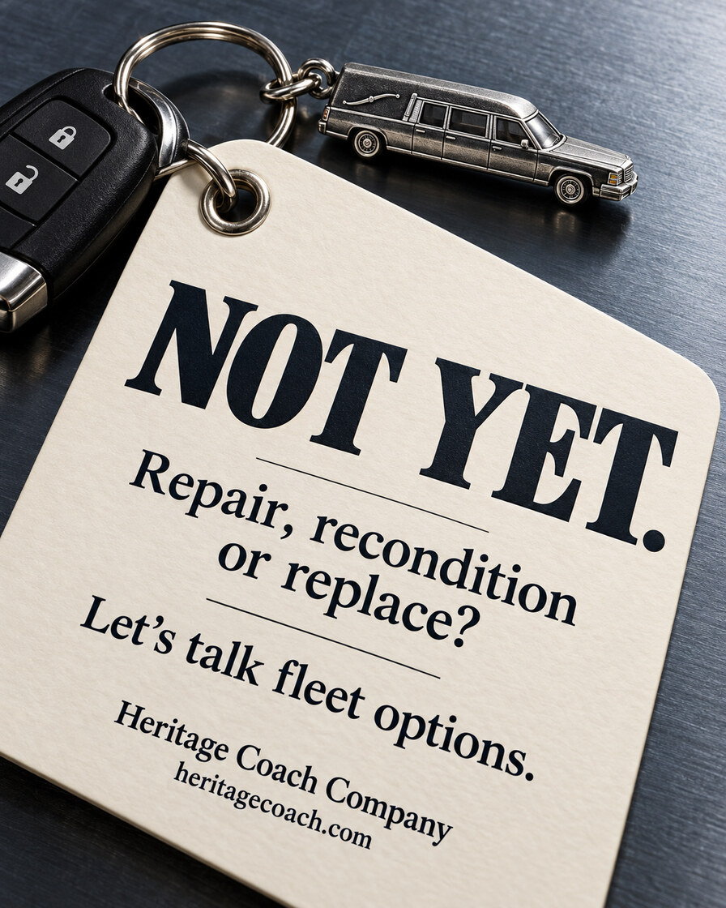
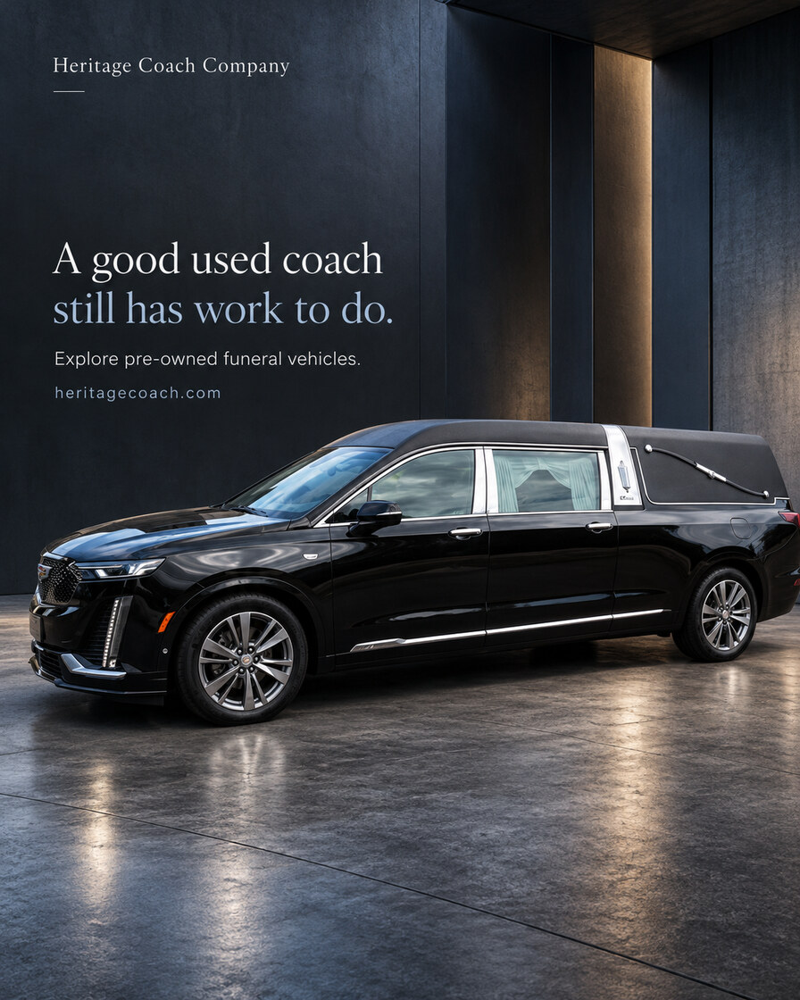
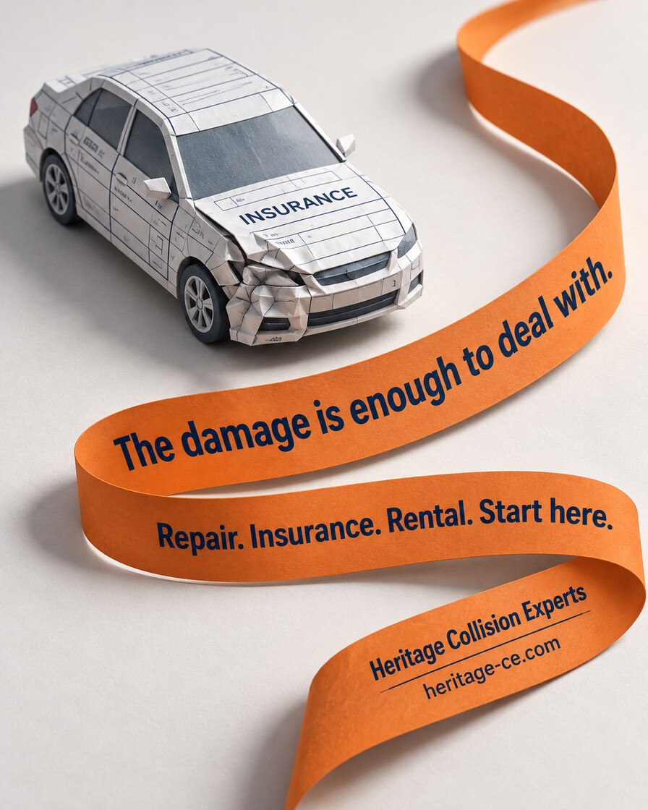
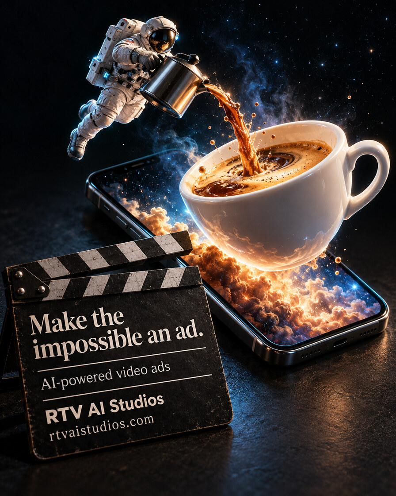

# Composition gallery: different reading paths, purposeful hierarchy

Use with [composition-review.md](../composition-review.md) and the required
[creative passes](../creative-passes.md); inspect the images when image viewing is
available. These are two selected pairs, one standalone benchmark and five selected composition
counterexamples from user-approved generated ads. They are teaching references, not
templates to copy. The counterexamples were selected on 2026-10-30; the earlier pairs
and benchmark are preserved unchanged.

The user liked the original ideas and preferred the cleaner versions, while leaving
room for both styles. That is a creative preference, not conversion proof. Rich and
clean compositions can both work. Judge whether each detail earns its attention by
supporting the premise, emotional meaning, product connection or reading order. Do not
turn these examples into a minimalism rule, fixed element count, blank-background
recipe or cast mandate.

**Evidence boundary:** These are multi-variable creative comparisons, not controlled
single-variable tests. Copy, layout, scene detail and CTA treatment change across the
pairs. No audience experiment or conversion result is supplied. Branding and offer
wording remain visible only in this narrow, user-approved teaching example; neither
is current offer evidence, reusable proof or permission to publish these ads. The
fictional scenes and generated people are not customer testimonials.

## Start with contrasting reading paths

Before borrowing from one image, compare it with a structurally different example
below and with Enough Mugs. The initial gallery overrepresented upper headlines and
stacked copy/hero/action, even though its prose warned against templates. Pictures can
teach an unintended default. Changing only the subject, character or medium does not
change the layout. Likewise, integrating all text into props must not become the next
unexamined default.

The five additions below were selected as examples **1, 2, 3, 4 and 9** from a ten-image
review. These numbers identify that selection, not rankings. Selection is subjective
creative approval, not measured audience performance. Each illustrates a choice and
its limits. A conventional stack or drawn button remains available when it serves the
brief; do not force novelty or require every ad to use a different layout.

### Selected 1. Not yet: the message belongs to a physical prop

- **Reading path:** The miniature coach establishes the category; the diagonal tag
  supplies the large central message, supporting question and conversational action.
  All copy lives on the prop rather than in separate headline and footer bands.
- **Why it fits:** A keytag connects a fleet decision to the object the operator uses.
  “Not yet” opens the repair, recondition or replace question; the next step is a
  conversation, not a forced button. The tag's scale gives the copy room to read.
- **Tradeoff / use:** Scene-integrated copy can feel natural when the prop earns the
  message, but perspective and texture can hurt legibility. This tag still contains
  an internal text hierarchy; the lesson is not that text blocks disappear. Use a
  real category cue and verify the entire prop at delivery size.

### Selected 2. Still has work to do: restrained product editorial

- **Reading path:** The vehicle and architecture establish a quiet product context;
  an upper-left copy group contains the benefit, invitation and URL. There is no
  separate bottom action bar. Typography follows available space rather than a
  fixed top-headline, center-image, bottom-button recipe.
- **Why it fits:** This was reviewed as **warm consideration**, not as proof of a cold
  visual interruption hook. A deliberate pre-owned-vehicle shopper can benefit from
  direct product relevance and restrained explanation. Do not relabel cold briefs
  as warm merely to excuse a weak opening.
- **Tradeoff / use:** It intentionally retains a conventional upper copy position.
  Variety does not mean every example must be unconventional. The representative
  generated coach differs from its source reference in grille, lights and wheels;
  it is **not actual inventory photography**, evidence of condition or a claim that
  a particular vehicle is available. Use verified unit photography for a listing.

### Selected 3. The damage is enough: copy follows the visual route

- **Reading path:** The damaged paper car and insurance cue establish the problem.
  The orange ribbon leads through message, service coordination and brand/action.
  The copy itself participates in the route instead of sitting above and below it.
- **Why it fits:** One continuous strip organizes several related burdens into one
  path. The paper-car metaphor connects to repair and insurance/rental coordination,
  not a decorative flourish attached to unrelated copy.
- **Tradeoff / use:** Curves and angled text require phone-size checks. This is still
  sequential copy, but its shape and path differ from a rectangular ad template.
  Generated form markings are illustrative texture, not customer documents. The
  service wording is not proof of insurance coverage, a free rental or an offer of
  insurance products; current service facts belong in the business repo.

### Selected 4. Dent reflection: a close-up carries the proposition

- **Reading path:** The reflection and dent are one focal event. Door handle and
  wheel arch preserve category context. A short plain-text action sits in an existing
  dark pocket; no headline banner or button separates it from the image.
- **Why it fits:** The problem changes the typography, so image and message explain
  each other. The macro crop gives an ordinary issue unusual visual scale.
- **Tradeoff / use:** A tighter crop could turn the dent into abstract texture. Keep
  enough context to recognize the problem and enough contrast for the next step.
  This is an illustrative damaged surface, not a customer job, repair outcome or
  before/after demonstration.

### Selected 9. Make the impossible an ad: purposeful spectacle

- **Reading path:** Astronaut, stream and cup create the first visual question; the
  phone connects the spectacle to a screen. A foreground slate explains the service
  and offers the next step in the scene, not in an external footer/button block.
- **Why it fits:** The impossible world demonstrates the kind of imaginative ad
  treatment being offered. It would be an unrelated gag without the readable
  video-ad proposition. The slate earns its place as a production object.
- **Tradeoff / use:** This is deliberately rich. Light, scale and the coffee stream
  keep the elements connected; adding competing props would weaken the path.
  Preserve service clarity at phone size. It is a conceptual illustration, not a
  delivered customer campaign, an agency endorsement or performance evidence.

## Original comparisons and standalone benchmark

The original examples below remain useful for studying selective emphasis. Compare
across the collection rather than copying the nearest picture's visual furniture.

## 1. Cupid off duty: keep the contradiction, reduce repeated decoration

| Original | Simplified |
| --- | --- |
|  |  |

- **Mechanism retained:** Cupid has traded arrows for music. Wings, heart-shaped piano
  and a discarded arrow give the headline a visible premise rather than decorating
  an otherwise generic musician portrait. The song is part of the resolution.
- **What changes:** The simplified scene removes the arrow basket, repeated arrows,
  scattered petals, foreground flowers and architectural arch. It retains the
  richly rendered character and piano, not merely an isolated product. The stronger
  separation around this group makes the main action easier to locate in this review.
- **Copy/layout confounds:** The headline loses “Some”; the support changes from
  “Turn your story into a personal love song.” to “Give your story a song.” Character
  and piano placement change too. “Preview it free.” remains the CTA in both.
- **Tradeoff:** The original's abandoned-arrow pile makes Cupid's change of method
  more explicit and the decorative setting adds romance. The simplified image gains
  breathing room but reduces that narrative evidence; the single arrow is a smaller
  clue at phone size. Shorter support is less explicit about personalization.
- **Use the lesson:** Remove redundant cues before removing the cue that makes the
  visual joke intelligible. Neither mythical casting nor a plain background is required.

## 2. Never-ending card: preserve the impossible scale, clarify its path

| Original | Simplified |
| --- | --- |
|  |  |

- **Mechanism retained:** A small card cannot contain the whole story. The impossible
  length makes that tension visible; the song copy supplies a way to express it.
- **What changes:** Stairs, open doorway, distant garden, patterned rugs, flowers,
  candles and small furnishings leave the simplified composition. One broad paper
  path now leads from card to foreground rather than competing with several distant
  bends and architectural lines. The reader's reaction remains part of the premise.
- **Copy/layout confounds:** Headline and support wording remain, but move from the
  upper left to the upper right. The CTA moves from a red lower-right button with an
  arrow to plain black type higher on the right. Brand placement and the subject's
  scale also change. Reduced decoration is not the only difference.
- **Tradeoff:** The original's paper extending outdoors exaggerates “never-ending”
  and gives the home a lived-in warmth. Its red CTA is more conspicuous. The simplified
  version clarifies the near-field card and face, but loses some scale, setting and
  CTA contrast. A review could retain useful environmental depth or a stronger CTA
  rather than choosing either whole treatment unchanged.
- **Use the lesson:** Simplify the visual route without deleting the exaggeration
  that carries the idea. A realistic human cast can support an absurd premise; cast
  and rendering are separate choices from scene density.

## 3. Enough mugs: standalone hierarchy benchmark, not a simplification pair

- **Mechanism:** An oversized familiar gift surrounds its unimpressed recipient.
  The human is inside a mug; this is not a talking object or an anthropomorphized
  product. Absurd scale and the human reaction create the visual question.
- **Hierarchy without an empty room:** The large, light mug and face dominate despite
  a sofa, window, fireplace, plants and rug. The furnishings establish domestic
  context but stay secondary in scale and contrast. A distinct dark text panel
  separates the payoff from the scene. Clean hierarchy need not mean few objects.
- **Connection and tradeoff:** The headline supplies the alternative, a song, and the
  support connects it to memories. The mug is the familiar gift being contrasted,
  not the advertised product. With copy hidden, the scene is an unusual gift joke,
  not a clear song proposition; the complete static must keep that connection
  readable. At phone width, the large headline remains clear but support is smaller.
- **Boundary:** This is an approved standalone creative benchmark, not evidence of
  what simplification changed or of conversion performance. Do not turn giant props,
  humans in objects, this cast or this panel layout into a mandatory template.

## Files and inspection

The ten embedded JPEGs are compact, full-frame derivatives of the selected source
PNGs, including original/simplified pairs and standalone examples. No crop, retouch, text change, layout edit or media generation was
performed for this gallery. Source originals remain untouched outside the repository.
[manifest.json](manifest.json) records stable example IDs, available source generation
artifact IDs, full-source and derivative SHA-256 hashes, dimensions, byte counts, encoding and
the mechanical conversion recipe. It contains no private paths or Library links.

The original five source images and derivatives were inspected on 2026-10-29; the
five selected additions and their derivatives were inspected on 2026-10-30. The
896 × 1120 derivatives preserve the complete compositions and readable headline,
support and CTA at full image size. Temporary 390-pixel-wide previews were also
inspected: headline and CTA remain readable, while footer URLs and the original
Cupid support line are small. For the new additions, the 390-pixel previews retain
the main message and action; the editorial coach support/URL and the dent example
brand/URL are smaller secondary reads. These are teaching tradeoffs, not permission
to shrink required production copy. Open each image for details; side-by-side Markdown
previews shrink the type further. Handwriting on the generated card is illustrative texture,
not verified readable copy or a real personal message. This gallery is visual teaching
material, not a placement safe-zone check or production approval.
